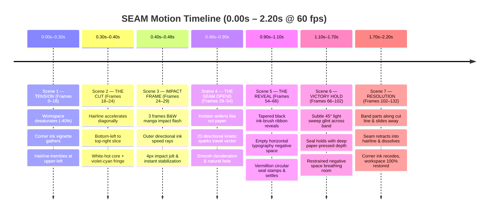

# ThemeFlow — SEAM: Cinematic Motion Design Advertisement

> **Concept:** An original anime-inspired victory sequence triggered upon a confirmed Accepted verdict.  
> **Aesthetic:** High-contrast manga impact frames, ink-and-paper negative space, razor-sharp diagonal incision, and vermillion seal accents on charcoal-black developer workspaces.

---

## Visual Keyframe Preview

---

## 1. Executive Summary & Creative Direction

| Parameter | Specification |
| :--- | :--- |
| **Aspect Ratio & Resolution** | 16:9 Widescreen • 1920 × 1080p (Native 60 fps) |
| **Pacing & Total Runtime** | Fast attack, crisp hold, clean dissolve • Exactly **2.20 seconds** (132 frames @ 60 fps) |
| **Camera Configuration** | Fixed locked-off camera; maximum subtle 4-pixel impact jolt at `t = 0.40s` (recovers in 2 frames) |
| **Dominant Palette** | Charcoal black (`#0c0d10`, `#14161b`), Stark paper white (`#f8fafc`), Deep ink black (`#000000`) |
| **Accent Fringe** | Violet-Cyan energy dispersion (`#8b5cf6` to `#06b6d4`, 3.5px aura width) |
| **Victory Seal** | Vermillion cinnabar red (`#e11d48` to `#dc2626`) circular stamp with subtle gold rim |
| **Strict Exclusions** | Zero green HUD boxes, zero toast widgets, no full-screen whiteouts, no confetti particles, no invented typography |

---

## 2. Frame-by-Frame Production Timeline

---

## 3. Scene Breakdown & Animation Specifications

### Scene 1 — Tension (`0.00s – 0.30s` / Frames 0–18)
- **Visuals:** The charcoal IDE workspace subtly desaturates by 35% using an exponential S-curve. Four delicate sumi-e ink washes creep inward from the screen corners, staying strictly out of the code editor line range.
- **Hairline:** At coordinate `(X: 180, Y: 120)`, a 1.2px pure white vector hairline appears, trembling with micro-vibrations (amplitude `0.8px`, frequency `24Hz`). Center composition remains pristine and clear.
- **Audio Cue (`0.30s`):** Short, airy reverse swell (whispering air intake) creates intense subconscious anticipation.

---

### Scene 2 — The Cut (`0.30s – 0.40s` / Frames 18–24)
- **Visuals:** The trembling hairline snaps into extreme directional acceleration along a 34° diagonal vector, traversing from `(X: 120, Y: 960)` to `(X: 1840, Y: 80)`.
- **Blade Geometry:**
  - **Core:** 3.0px solid incandescent paper white (`#ffffff`).
  - **Fringe:** 4.5px chromatic dispersion gradient shifting from electric violet (`#a855f7`) at the head to radiant cyan (`#22d3ee`) along the trailing edge.
- **Motion Curve:** `cubic-bezier(0.85, 0.0, 0.15, 1.0)` — instantaneous hyperspeed attack.
- **Audio Cue (`0.34s`):** Bright, razor-sharp metallic katana whoosh synchronized exactly to the visual blade apex.

---

### Scene 3 — Manga Impact Frame (`0.40s – 0.48s` / Frames 24–29)
- **Visuals:** 3 alternating frames of stark black-and-white manga negative space:
  - *Frame 25:* Inverted negative flash confined to a 320px diagonal swath around the cut.
  - *Frame 26:* 8 bold, high-contrast black ink speed rays extending inward from the screen perimeter.
  - *Frame 27:* Instantaneous snap back to color with lingering incandescent incision.
- **Camera Jolt:** 4-pixel vertical impact displacement on Frame 25, settling to 0px by Frame 27.
- **Audio Cue (`0.40s`):** Short, dry impact hit with tight low-frequency body (95Hz punch, zero muddy resonance).

---

### Scene 4 — The Seam Opens (`0.48s – 0.90s` / Frames 29–54)
- **Visuals:** The incision separates cleanly like heavy cotton paper parted by an invisible scalpel, opening an 18px gap at the midpoint.
- **Particle Dynamics:** Exactly 18–20 crisp, needle-thin diamond sparks release along the cut vector. Sparks exhibit aerodynamic deceleration (`vx *= 0.91, vy *= 0.91`), traveling 40–120px before dissolving into negative space. Zero floating confetti.

---

### Scene 5 — The Reveal (`0.90s – 1.10s` / Frames 54–66)
- **Visuals:** A tapered black ink-brush ribbon expands horizontally across the upper center `(Y: 280)`.
- **Typography Area:** The interior horizontal band is left pristine, solid, and completely empty during rendering, ready for typography insertion in post-production.
- **Vermillion Seal:** A vermillion circular seal (`#e11d48`) stamps firmly into the right end of the ribbon at Frame 62 with a snappy 1.12x scale-bounce and 4° settling twist.
- **Audio Cue (`0.95s`):** Two ascending crystal-glass bell notes with a delicate shimmering harmonic tail.

---

### Scene 6 — Victory Hold (`1.10s – 1.70s` / Frames 66–102)
- **Visuals:** The composition holds with quiet authority. A single 45° delicate white-cyan light glint sweeps across the brush ribbon from left to right over 0.45s.
- **Depth:** Subtle ambient occlusion beneath the seal gives it tactile pressed-paper weight.

---

### Scene 7 — Resolution (`1.70s – 2.20s` / Frames 102–132)
- **Visuals:** The black ink ribbon cleaves along the diagonal incision line; the top-right half slides upward-right and the bottom-left half slides downward-left (`transform: translate(...)`).
- **Cleanup:** The seam closes back into a fine hairline and evaporates. The corner ink vignettes recede into the screen borders.
- **Restoration:** At `2.20s`, the workspace returns 100% to its original active state with zero layout shifts, lingering overlays, or dropped frames.

---

## 4. Post-Production Compositing Guide

When importing the motion render into your NLE (Adobe Premiere, After Effects, DaVinci Resolve, or Final Cut):

1. **Typography Overlay Track:**
   - **Text:** `ACCEPTED`
   - **Font:** Clean, geometric neo-grotesque or bold monospace (`Inter Display`, `JetBrains Mono`, or `Futura Bold`).
   - **Tracking / Letterspacing:** `+0.28em` uppercase.
   - **Color:** Paper White (`#f8fafc`) with a subtle 12px outer glow (`rgba(255, 255, 255, 0.45)`).
   - **Placement:** Centered horizontally inside the black ink-brush band.
2. **Seal Stamp Art Track:**
   - **Emblem:** Vector Japanese-inspired `AC` / verified kanji seal (`44px × 44px`).
   - **Color:** Vermillion red `#dc2626` with clean white vector linework.
3. **Audio Alignment Track:**
   - Track 1 (`0.30s`): Reverse swell.
   - Track 2 (`0.34s`): Katana blade whoosh.
   - Track 3 (`0.40s`): Sub-bass impact thud.
   - Track 4 (`0.95s`): Dual ascending crystal glass bells.
